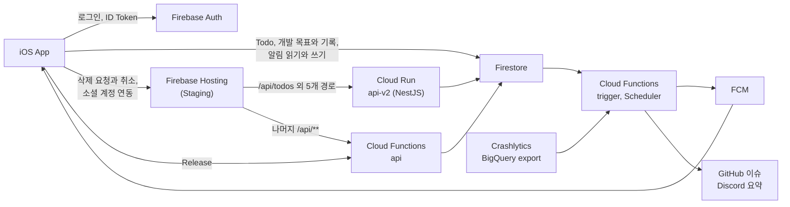

# DevLog Labs

> 개발 기록과 Todo를 한 곳에서 관리하는 앱 DevLog의 iOS 클라이언트와 Firebase 백엔드  
> 기획부터 앱 개발, 서버 구성, 배포 자동화까지 혼자 만들고 운영하는 프로젝트

<table>
	<tr>
		<td align="center" width="25%">
			
		</td>
		<td align="center" width="25%">
			
		</td>
		<td align="center" width="25%">
			
		</td>
		<td align="center" width="25%">
			
		</td>
	</tr>
	<tr>
		<td align="center">홈</td>
		<td align="center">오늘</td>
		<td align="center">푸시 알림</td>
		<td align="center">히트맵</td>
	</tr>
</table>

## 한눈에 보기

| 항목 | 내용 |
| --- | --- |
| 서비스 | App Store 출시 (iPhone, iPad, Apple Silicon Mac) |
| 출시 | 2026.04 출시 (현재 버전 1.5.3) |
| 기간 | 2026.02 ~ 2026.10 |
| 역할 | 기획, iOS 클라이언트, Firebase 백엔드, 배포 자동화 전담 (1인) |
| 클라이언트 | SwiftUI, The Composable Architecture, Tuist 12개 모듈, WidgetKit |
| 백엔드 | Firestore, Cloud Functions, FCM, NestJS (Cloud Run, Staging) |
| 품질 | 테스트 파일 79개 (PR CI는 이 중 71개 실행) |

## 저장소

| 저장소 | 책임 | 스택 |
| --- | --- | --- |
| [iOS](https://github.com/DevLog-Labs/iOS) | 앱, 위젯, 마크다운 렌더러(WKWebView 기반) | Swift, SwiftUI, TCA, Tuist, TypeScript |
| [Firebase](https://github.com/DevLog-Labs/Firebase) | 푸시, 데이터 정리, 장애 리포트, HTTP API | TypeScript, Cloud Functions, NestJS |

## 프로젝트 아키텍처

- 데이터 조회와 저장은 앱이 Firestore를 직접 사용하고 삭제와 계정 연동처럼 서버 규칙이 필요한 작업만 HTTP API를 거침
- Debug와 Staging은 Hosting에서 경로별로 Cloud Run과 Cloud Functions로 나누고 Release는 Cloud Functions `api`를 호출
- Staging과 Production은 Firebase project를 분리하며 build configuration으로 선택

## 주요 성과

### 앱

#### 1. SwiftUI 화면에서 상태 변경에 따라 재평가되는 영역을 각각 구조체 View로 분리해 불필요한 화면 재평가 축소

> **배경** 
> • SwiftUI는 View가 읽는 상태가 바뀌면 그 View의 `body`를 다시 계산(재평가)함 
> • 재평가는 화면을 다시 그리기(재렌더링) 위한 준비 단계이며 실제 그리기와는 별개임 
> • 홈, 알림 목록, Todo 목록 화면에는 검색어 입력, 필터 전환, 카테고리 펼치기 같은 작은 상호작용이 있음
>
> **문제** 
> • 계산 프로퍼티로 구성한 내부 View가 읽는 상태가 바뀌면 그 View를 담은 부모 View의 `body` 전체가 다시 평가됨 
> • 작은 상호작용에도 화면 전체가 다시 평가됨
>
> **해결 과정** 
> • 상태 변경에 따라 재평가되는 영역을 같은 파일의 구조체 View로 분리하고 `store`(화면 상태 저장소)를 전달해 해당 View의 `body`에서만 상태를 읽게 함 
> • 분리 기준은 읽는 상태이며 상태와 무관한 영역과 `send`만 호출하는 버튼은 분리하지 않고 부모에 유지 
> • 반복되는 항목은 `store` 없이 값만 전달받는 구조체 View로 유지하거나 분리 
> • 화면마다 Instruments의 `View Body (Legacy)`로 변경 전후의 재평가 횟수와 시간을 측정
>
> **결과** (Release 최적화(Staging) 빌드, iPhone 18 Pro 시뮬레이터(iOS 27.0), 변경 전후 각 5회 중앙값) 
> • Todo 목록(더미 60건)에서 검색어를 한 글자씩 입력하는 키 입력 48번 기준으로 목록 화면 View 1개와 분리한 View 4개의 평가 시간 합이 69.55ms에서 26.31ms로 감소 (5회 범위 68.34 ~ 75.86ms에서 25.26 ~ 27.07ms로) 
> • 같은 시나리오에서 목록 화면(부모 View)의 `body`는 최초 표시 때 1회만 평가되고 입력창 49회, 결과 목록 96회, 필터 헤더 50회처럼 분리한 View가 대신 평가됨 (최초 표시 포함) 
> • 알림 목록(더미 60건)의 필터 전환 30회 기준 같은 방식으로 합산한 평가 시간 32.33ms에서 20.28ms로, Todo 목록의 검색 열기와 취소 10회 기준 37.16ms에서 20.92ms로 감소
>
> **트레이드오프** 
> • 분리한 View가 추가로 평가되어 평가 횟수의 합은 늘었으나 시간의 합은 줄어듦 (검색어 입력 시 목록 화면과 분리한 View 4개의 평가 횟수 합 136회에서 200회로 증가)

#### 2. 알림 탭의 당겨서 새로고침(pull-to-refresh)이 앱을 종료시키던 문제를 `@MainActor` 격리로 해결

> **배경** 
> • SwiftUI의 `.refreshable`은 목록을 아래로 당기면 `async` 클로저를 실행해 새로고침을 수행하는 기능임 
> • 상태 저장소 `Store`의 `send` 안에서 `dispatch_assert_queue`가 호출 큐를 검사함
>
> **문제** 
> • 알림 탭에서 당겨서 새로고침하면 앱이 종료되고 `EXC_BREAKPOINT`가 발생함 
> • 호출 스택은 SwiftUI의 새로고침 컨트롤에서 `PushNotificationListView`의 새로고침 클로저를 거쳐 `Store.send`의 `dispatch_assert_queue`에서 실패함 
> • 새로고침 클로저에 `MainActor` 격리가 없어 `Store.send`가 비동기 작업 실행 큐에서 호출됨
>
> **해결 과정** 
> • 새로고침 액션의 타입을 `@Sendable`에서 `@MainActor @Sendable`로 바꿔 `MainActor` 격리를 추가 
> • `.refreshable` 내부에서 `await action()`으로 호출해 `.refresh`와 `.startObserving`이 `MainActor`에서 실행되도록 보장 
> • TCA 내부 `send` 구현과 알림 갱신 순서는 변경하지 않음
>
> **결과** (Debug 빌드, iPhone 18 Pro 시뮬레이터(iOS 27.0), 알림 탭에서 당겨서 새로고침 각 3회) 
> • 수정 전 3회 모두 앱이 종료되고 수정 후 3회 모두 정상 동작 
> • 수정 전후 모두 TCA 1.26.2로 빌드해 비교

#### 3. 단방향 흐름만 제어하던 자체 Store 프로토콜을 SwiftUI 상태 관리 라이브러리 TCA로 전환

> **배경** 
> • 화면의 상태와 이벤트를 다루는 구조로 자체 `Store` 프로토콜을 사용했으며 Action이 State를 바꾸는 단방향 흐름만 제어함 
> • 기존 구조에 장애나 결함은 없었으나 시트, 얼럿, 토글 값은 뷰에서 `Binding(get:set:)`으로 직접 구성함 
> • 전환 직전 23개 뷰 파일에 `Binding(` 구성이 67곳 있었음 
> • 전환 동기는 뷰의 `Binding` 구성을 Feature로 옮겨 뷰 코드를 줄이고 시트, 얼럿, 이동 대상(destination) 상태까지 라이브러리가 형태를 강제해 화면마다 구성 방식이 갈리지 않게 하는 것
>
> **전환 과정** 
> • Binding은 TCA의 `BindingAction`으로, 시트와 얼럿은 `@Presents`와 `AlertState`로, 겹칠 수 있는 요청은 취소 ID와 `cancelInFlight`로 Feature(화면 단위 상태 모듈)에서 처리 
> • 화면 단위 15개 PR(2026-06-05~06-17)로 전환하고 마지막 PR에서 자체 Store를 제거 (`NavigationStack` 경로는 전환 대상에서 제외하고 `NavigationRouter`가 계속 소유) 
> • ViewModel 테스트는 TCA의 테스트 도구 `TestStore` 기반 Feature 테스트로 이전해 상태 변화가 같은지 확인
>
> **결과** 
> • 23개 뷰 파일의 `Binding(` 구성 67곳에서 16곳으로, 뷰 총 줄 수 4,860줄에서 4,756줄로 감소 (grep 기준)
>
> **트레이드오프** 
> • 외부 의존성이 늘었고 린트 도구 SwiftLint의 SPM 플러그인이 swift-syntax와 충돌해 SwiftLint 실행을 Homebrew 방식으로 바꿈

### 백엔드

#### 1. 삭제 후 Undo를 서버 문서의 soft delete와 복구 요청으로 바꿔 페이지네이션이 삭제한 항목을 되살리던 문제를 해결

> **배경** 
> • Todo, 알림, 웹페이지를 삭제한 뒤 짧은 시간 안에 Undo(삭제 취소)할 수 있음 
> • soft delete는 문서를 지우지 않고 삭제 표시만 남기는 방식임
>
> **문제** 
> • 1단계(앱 지연 삭제): 알림과 웹페이지의 삭제 대기 상태를 앱 메모리(`pendingTask`)가 쥐고 토스트가 닫힐 때 실제로 삭제함 
> • 알림 목록에서 대기 중에도 서버는 항목을 갖고 있어 토스트가 떠 있는 동안 페이지네이션 fetch 결과에 삭제한 항목이 섞여 목록에 다시 나타남 
> • 대기 중 페이지네이션을 막고 append를 필터링하는 방어 로직을 추가했으나 삭제 상태를 앱 메모리가 쥐는 구조는 그대로라 계속 추가해야 하고 다른 화면이나 기기와 삭제 상태를 공유하지 못함 
> • 2단계(서버 지연 삭제): 알림과 웹페이지는 서버 문서에 `deletingAt`을 기록하고 Undo를 서버 취소 요청으로 바꿔 삭제 상태를 서버로 옮겼으나 최종 삭제를 Cloud Tasks 작업 큐에 맡긴 반면 Todo는 즉시 soft delete를 써서 삭제 방식이 갈림 
> • 로컬 Firebase Emulator에서는 큐 등록에 별도 Google credential이 필요해 통합 테스트가 `500 INTERNAL`로 실패함
>
> **해결 과정** 
> • 통합 테스트의 `500 INTERNAL` 원인을 찾으려 `catch` 내부 cleanup의 2차 예외와 원래 예외를 분리 로깅해 큐 등록 단계의 credential 오류임을 확인 
> • 3단계(즉시 soft delete): 앱에서 삭제하면 서버가 문서를 즉시 soft delete하고(Todo는 `deletedAt`, 알림과 웹페이지는 `isDeleted`) 앱에서 Undo하면 서버에 복구를 요청하도록 바꿔 세 도메인의 삭제를 같은 방식으로 맞추고 삭제용 Cloud Tasks 경로를 제거 
> • 알림 조회는 `isDeleted == false` 문서만 가져오고 사용자가 삭제한 항목은 서버에 반영되기 전까지 앱이 로컬에서 숨김 
> • 매일 09:00 (KST)에 Cloud Scheduler가 삭제 표시된 알림과 웹페이지 문서를 제거하고 삭제 후 24시간이 지난 Todo는 필드를 13개에서 8개로 줄임 (개발 목표가 연결되지 않은 Todo 기준)
>
> **결과** 
> • 서버 반영 후에는 알림 조회가 삭제된 문서를 가져오지 않아 다음 페이지 응답에 삭제한 항목이 포함되지 않고 1단계에서 추가했던 삭제 대기 중 페이지네이션 차단 없이 `loadNextPage`가 동작함 (되살아남을 재현하는 테스트는 없고 쿼리 조건과 코드로 확인)
>
> **트레이드오프** 
> • Undo가 서버 요청이므로 실패 시 숨김 복원과 오류 안내 처리가 필요 
> • 서버에 반영되기 전 구간은 앱의 로컬 숨김과 서버 스냅샷의 병합이 필요 
> • 삭제한 문서는 정리 작업이 실행되기 전까지 저장소에 남음 
> • 알림과 웹페이지는 정리 작업에 유예 기간이 없어 09:00 (KST) 정리와 겹친 삭제는 Undo해도 복구되지 않을 수 있음

#### 2. Todo 리마인더를 이벤트별 예약 대신 사용자 시간대 기준 5분 배치와 작업 큐로 분리

> **배경** 
> • 마감일이 내일인 미완료 Todo에 대해 사용자가 정한 시각에 푸시 알림(리마인더)을 보냄 
> • 알림 허용 여부와 시각 설정은 사용자마다 다르며 시간대도 사용자 로컬 기준임
>
> **문제** 
> • Todo 생성과 수정 이벤트마다 리마인더를 예약하면 이후 사용자가 알림 시각이나 시간대를 바꿔도 이미 만든 예약에는 반영되지 않아 어긋남 
> • Todo 수정으로 중복 예약이 생길 수 있음 
> • 서버 시간대를 고정하면 사용자 로컬 날짜 기준의 내일 마감을 판단할 수 없음
>
> **해결 과정** 
> • `scheduleTodoReminder`(Cloud Functions)가 5분마다 사용자의 시간대와 설정 시각을 검사해 로컬 기준 다음 날 마감인 미완료 Todo를 Cloud Tasks에 넣음 
> • `sendPushNotification`이 발송 직전에 설정, 완료 여부, 카테고리, 현재 마감일을 다시 검증 
> • `todoId_dueDateKey`로 이름 붙인 발송 기록(dispatch) 문서를 트랜잭션으로 선점
>
> **결과** 
> • Todo별 예약 수명 관리 없이 설정 변경이 다음 실행부터 반영 
> • 결정적 dispatch 키와 트랜잭션 선점으로 재시도와 동시 실행에서도 중복 알림을 막는 구조
>
> **트레이드오프** 
> • 5분마다 조회 비용이 발생하고 알림 시각은 5분 단위로 처리됨 
> • Scheduler, Cloud Tasks, dispatch 문서의 운영 상태를 함께 관리해야 함

#### 3. HTTP API 요청 계약을 유지한 채 Cloud Functions에서 NestJS(Cloud Run)로 URL 경로 기반으로 이전

> **배경** 
> • 앱의 HTTP API(Todo, 웹페이지, 푸시 알림, Google·Apple·GitHub 로그인)를 Cloud Functions 함수 `api` 하나가 모두 처리했음 
> • 이 API를 Cloud Run에서 실행하는 NestJS 서버(`api-v2`)로 옮기는 중이며 Firebase Hosting이 경로별로 요청을 나눠 보냄
>
> **문제** 
> • 모든 HTTP 요청을 함수 `api` 하나가 처리하고 있어 한 번에 교체하면 모든 경로의 요청 계약이 동시에 바뀜 
> • 앱 호환성을 한 번에 검증해야 함
>
> **해결 과정** 
> • Firebase Hosting rewrite로 `/api/todos`, `/api/web-pages`, `/api/push-notifications`, `/api/auth/google`, `/api/auth/apple`, `/api/auth/github` 경로만 Cloud Run `api-v2`로 보내고 나머지 `/api/**`는 기존 함수 `api`가 `404`로 응답 
> • 모든 업무 요청은 Firebase ID Token으로 검증하고 서비스 계정 키 없이 ADC(Application Default Credentials)를 사용 
> • OAuth 설정은 Secret Manager로 분리하고 Cloud Run 인스턴스는 최소 0개 최대 3개로 구성
>
> **현재 상태** 
> • Staging 환경에서 이 6개 경로를 Cloud Run이 처리하고 Release는 Cloud Functions `api` 사용 
> • 최종 목표는 함수 `api`가 담당하는 HTTP API 전체 이전 
> • PR마다 lint, build, 단위 테스트, e2e 테스트, Docker 이미지 build 확인

## 운영 방식

- 이슈 번호 기준으로 PR을 작성하고 템플릿(연관된 이슈, 의도, 작업 내용)을 사용
- iOS CI: 마크다운 렌더러 빌드 결과와 커밋된 번들의 일치 검사, 빌드, SwiftLint, 7개 그룹(App, Domain-Data, Infra, Persistence, Libraries, Presentation, Widget) 테스트
- Firebase CI: Functions build와 테스트, NestJS lint, build, 단위 테스트, e2e 테스트, Docker 이미지 build
- 배포: Fastlane과 GitHub Actions 수동 실행으로 TestFlight와 App Store 업로드

## 기술 스택

| 구분 | 스택 |
| --- | --- |
| Client | Swift, SwiftUI, WidgetKit, AppIntents, The Composable Architecture, Combine, async/await |
| Architecture | Clean Architecture (Tuist 모듈 분리) |
| Backend | Firestore, Cloud Functions, Cloud Run (NestJS), Firebase Hosting, Cloud Messaging, Cloud Scheduler |
| Auth | Firebase Authentication, Google, GitHub, Apple 로그인 |
| Monitoring | Firebase Analytics, Crashlytics (BigQuery export) |
| Testing | swift-testing, TCA TestStore, Node 테스트 스크립트(Functions), Jest(NestJS 단위, e2e) |
| Tooling | Xcode, Tuist, mise, Swift Package Manager, SwiftLint, Fastlane, GitHub Actions, Docker |
